# Effect gallery

All **82** built-in effects, rendered frame by frame by the real `matrix_core::Engine` — not screenshots, not hardware footage. 4 s at 25 fps with one synthetic audio track, identical on every run.

65 are audio reactive. Contact sheets sample each clip at 10/30/50/70/85/95 %.

Rendered by `cargo run -p matrix-gif -- --all`. Repository: <https://github.com/nicolai455/led-matrix-anim-rs>

---

### TestPattern · `TestPattern`

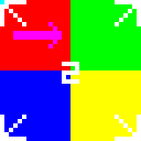

7 colours · [contact sheet](contact-sheets/001-TestPattern.png)

### Rainbow · `Rainbow`

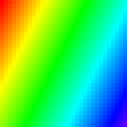

94 colours · [contact sheet](contact-sheets/002-Rainbow.png)

### Solid · `Solid`

1 colours · [contact sheet](contact-sheets/003-Solid.png)

### TextStatic · `TextStatic`

2 colours · [contact sheet](contact-sheets/004-TextStatic.png)

### TextScroll · `TextScroll`

2 colours · [contact sheet](contact-sheets/005-TextScroll.png)

### Black Hole · `black_hole`

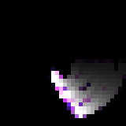

247 colours · parameters · [contact sheet](contact-sheets/006-black_hole.png)

### Fire · `fire`

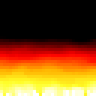

404 colours · audio reactive · parameters · [contact sheet](contact-sheets/007-fire.png)

### Plasma · `plasma`

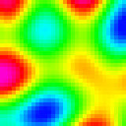

699 colours · audio reactive · parameters · [contact sheet](contact-sheets/008-plasma.png)

### Starfield · `starfield`

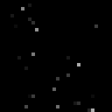

14 colours · audio reactive · parameters · [contact sheet](contact-sheets/009-starfield.png)

### Matrix Rain · `matrix_rain`

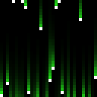

29 colours · audio reactive · parameters · [contact sheet](contact-sheets/010-matrix_rain.png)

### Ripple · `ripple`

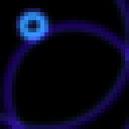

557 colours · audio reactive · parameters · [contact sheet](contact-sheets/011-ripple.png)

### Frequency Bars · `freq_bars`

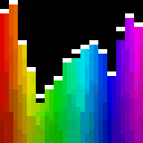

798 colours · parameters · [contact sheet](contact-sheets/012-freq_bars.png)

### Spectrogram · `spectrogram`

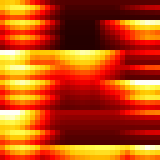

476 colours · parameters · [contact sheet](contact-sheets/013-spectrogram.png)

### Audio Pulse · `audio_pulse`

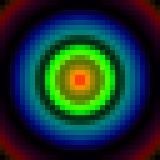

109 colours · parameters · [contact sheet](contact-sheets/014-audio_pulse.png)

### Pulse Ball · `pulse_ball`

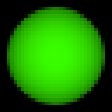

70 colours · parameters · [contact sheet](contact-sheets/015-pulse_ball.png)

### Rotating Fish · `rotating_fish`

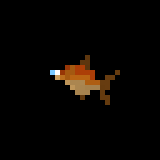

24 colours · parameters · [contact sheet](contact-sheets/016-rotating_fish.png)

### Spinning Donut · `spinning_donut`

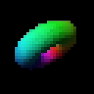

270 colours · parameters · [contact sheet](contact-sheets/017-spinning_donut.png)

### Spinning Cube · `spinning_cube`

4 colours · parameters · [contact sheet](contact-sheets/018-spinning_cube.png)

### Waveform · `audio_waveform`

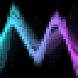

634 colours · parameters · [contact sheet](contact-sheets/019-audio_waveform.png)

### Radial Spectrum · `radial_spectrum`

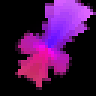

798 colours · parameters · [contact sheet](contact-sheets/020-radial_spectrum.png)

### Stroboscope · `stroboscope`

1 colours · audio reactive · parameters · [contact sheet](contact-sheets/021-stroboscope.png)

### Frames · `Frames`

1 colours · [contact sheet](contact-sheets/022-Frames.png)

> Renders black without an external audio/LFX source — documented default, not a render fault.

### Metaballs · `metaballs`

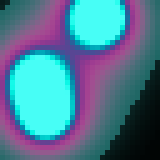

462 colours · audio reactive · parameters · [contact sheet](contact-sheets/023-metaballs.png)

### Kaleidoscope · `kaleidoscope`

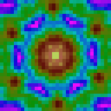

501 colours · audio reactive · parameters · [contact sheet](contact-sheets/024-kaleidoscope.png)

### Audio Tunnel · `audio_tunnel`

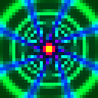

228 colours · audio reactive · parameters · [contact sheet](contact-sheets/025-audio_tunnel.png)

### Particle Fireworks · `fireworks`

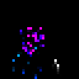

97 colours · audio reactive · parameters · [contact sheet](contact-sheets/026-fireworks.png)

### DNA Spiral · `dna_spiral`

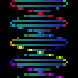

138 colours · audio reactive · parameters · [contact sheet](contact-sheets/027-dna_spiral.png)

### Lissajous · `lissajous`

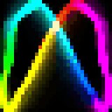

673 colours · audio reactive · parameters · [contact sheet](contact-sheets/028-lissajous.png)

### Game of Life · `game_of_life`

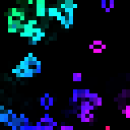

342 colours · audio reactive · parameters · [contact sheet](contact-sheets/029-game_of_life.png)

### Polar Lights · `polar_lights`

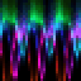

953 colours · audio reactive · parameters · [contact sheet](contact-sheets/030-polar_lights.png)

### Domain Warp · `domain_warp`

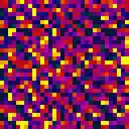

802 colours · audio reactive · parameters · [contact sheet](contact-sheets/031-domain_warp.png)

### Galaxy Spiral · `galaxy_spiral`

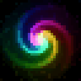

828 colours · audio reactive · parameters · [contact sheet](contact-sheets/032-galaxy_spiral.png)

### Text Effects · `text_effects`

2 colours · audio reactive · parameters · [contact sheet](contact-sheets/033-text_effects.png)

### Scene Sequencer · `scene_sequencer`

462 colours · parameters · [contact sheet](contact-sheets/034-scene_sequencer.png)

### Disco Mirror Ball · `disco_ball`

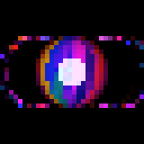

284 colours · audio reactive · parameters · [contact sheet](contact-sheets/035-disco_ball.png)

### Club Laser Show · `laser_show`

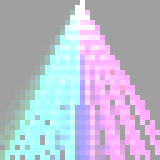

333 colours · audio reactive · parameters · [contact sheet](contact-sheets/036-laser_show.png)

### 80s Disco Floor · `disco_floor`

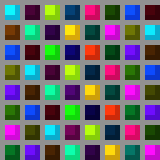

80 colours · audio reactive · parameters · [contact sheet](contact-sheets/037-disco_floor.png)

### Nyan Cat Space Loop · `nyan_cat`

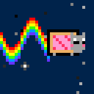

33 colours · audio reactive · parameters · [contact sheet](contact-sheets/038-nyan_cat.png)

### Party Pixel Dancers · `party_dancers`

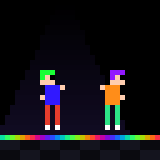

69 colours · audio reactive · parameters · [contact sheet](contact-sheets/039-party_dancers.png)

### Pacman Retro Chase · `pacman_chase`

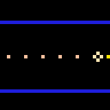

8 colours · audio reactive · parameters · [contact sheet](contact-sheets/040-pacman_chase.png)

### Equalizer Cyber City · `equalizer_city`

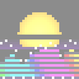

167 colours · audio reactive · parameters · [contact sheet](contact-sheets/041-equalizer_city.png)

### Club Strobe Blinders · `strobe_blinder`

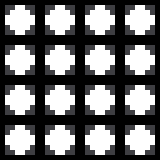

8 colours · audio reactive · parameters · [contact sheet](contact-sheets/042-strobe_blinder.png)

### Spinning DJ Vinyl · `spinning_vinyl`

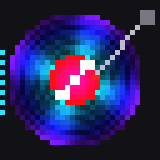

134 colours · audio reactive · parameters · [contact sheet](contact-sheets/043-spinning_vinyl.png)

### Bouncing Woofers · `bouncing_speakers`

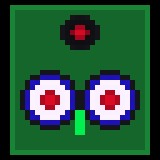

59 colours · audio reactive · parameters · [contact sheet](contact-sheets/044-bouncing_speakers.png)

### Pulsing Neon Heart · `neon_heart`

327 colours · audio reactive · parameters · [contact sheet](contact-sheets/045-neon_heart.png)

### Liquid Lava Lamp · `lava_lamp`

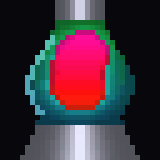

347 colours · audio reactive · parameters · [contact sheet](contact-sheets/046-lava_lamp.png)

### Space Invaders Galaxy · `arcade_invaders`

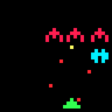

6 colours · audio reactive · parameters · [contact sheet](contact-sheets/047-arcade_invaders.png)

### 3D Ripple Mesh · `audio_mesh`

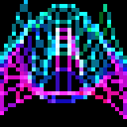

250 colours · audio reactive · parameters · [contact sheet](contact-sheets/048-audio_mesh.png)

### Fire Tornado · `fire_tornado`

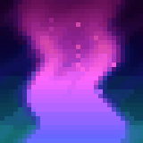

796 colours · audio reactive · parameters · [contact sheet](contact-sheets/049-fire_tornado.png)

### Hypnotic Moire Spirals · `hypno_spirals`

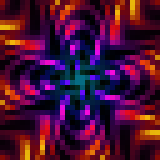

254 colours · audio reactive · parameters · [contact sheet](contact-sheets/050-hypno_spirals.png)

### Outrun Sunset Drive · `outrun_drive`

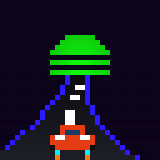

48 colours · audio reactive · parameters · [contact sheet](contact-sheets/051-outrun_drive.png)

### Spectrum Orb · `spectrum_orb`

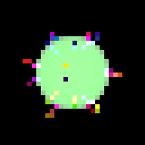

87 colours · audio reactive · parameters · [contact sheet](contact-sheets/052-spectrum_orb.png)

### Cyber Matrix Rain · `cyber_rain`

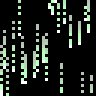

116 colours · audio reactive · parameters · [contact sheet](contact-sheets/053-cyber_rain.png)

### Fractal Julia Orbit · `julia_orbit`

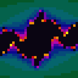

17 colours · audio reactive · parameters · [contact sheet](contact-sheets/054-julia_orbit.png)

### Plasma Rotozoom · `rotozoom`

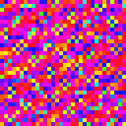

660 colours · audio reactive · parameters · [contact sheet](contact-sheets/055-rotozoom.png)

### Hazard Pulsar · `hazard_pulsar`

119 colours · audio reactive · parameters · [contact sheet](contact-sheets/056-hazard_pulsar.png)

### Supernova Shockwave · `supernova`

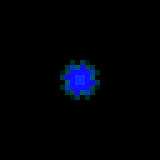

210 colours · audio reactive · parameters · [contact sheet](contact-sheets/057-supernova.png)

### Liquid Water Caustics · `water_caustics`

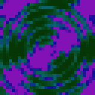

287 colours · audio reactive · parameters · [contact sheet](contact-sheets/058-water_caustics.png)

### Retro Breakout · `retro_breakout`

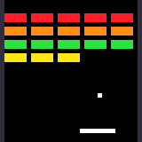

8 colours · audio reactive · parameters · [contact sheet](contact-sheets/059-retro_breakout.png)

### Hex Cyber Tunnel · `cyber_tunnel`

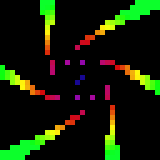

57 colours · audio reactive · parameters · [contact sheet](contact-sheets/060-cyber_tunnel.png)

### Fire & Ice Yin-Yang · `yin_yang`

54 colours · audio reactive · parameters · [contact sheet](contact-sheets/061-yin_yang.png)

### Retro UFO Abduction · `ufo_abduction`

146 colours · audio reactive · parameters · [contact sheet](contact-sheets/062-ufo_abduction.png)

### Dancing Banana · `dancing_banana`

59 colours · audio reactive · parameters · [contact sheet](contact-sheets/063-dancing_banana.png)

### Bongo Cat · `bongo_cat`

11 colours · audio reactive · parameters · [contact sheet](contact-sheets/064-bongo_cat.png)

### Popcat · `popcat`

34 colours · audio reactive · parameters · [contact sheet](contact-sheets/065-popcat.png)

### Dancing Skeleton · `dancing_skeleton`

6 colours · audio reactive · parameters · [contact sheet](contact-sheets/066-dancing_skeleton.png)

### Doge Much Wow · `doge_wow`

11 colours · audio reactive · parameters · [contact sheet](contact-sheets/067-doge_wow.png)

### Flappy Bird Loop · `flappy_bird`

14 colours · audio reactive · parameters · [contact sheet](contact-sheets/068-flappy_bird.png)

### Mario Goomba Stomp · `mario_stomp`

17 colours · audio reactive · parameters · [contact sheet](contact-sheets/069-mario_stomp.png)

### Hamster Dance · `hamster_dance`

10 colours · audio reactive · parameters · [contact sheet](contact-sheets/070-hamster_dance.png)

### Party Duck · `party_duck`

12 colours · audio reactive · parameters · [contact sheet](contact-sheets/071-party_duck.png)

### Party Minion · `party_minion`

14 colours · audio reactive · parameters · [contact sheet](contact-sheets/072-party_minion.png)

### Police Strobe Beacon · `police_strobe`

33 colours · audio reactive · parameters · [contact sheet](contact-sheets/073-police_strobe.png)

### Moving Head Spotlights · `moving_heads`

478 colours · audio reactive · parameters · [contact sheet](contact-sheets/074-moving_heads.png)

### Laser Tunnel Scanner · `laser_scanner`

19 colours · audio reactive · parameters · [contact sheet](contact-sheets/075-laser_scanner.png)

### Disco Pinwheel · `disco_pinwheel`

452 colours · audio reactive · parameters · [contact sheet](contact-sheets/076-disco_pinwheel.png)

### Octopus Scanner · `octopus_scanner`

88 colours · audio reactive · parameters · [contact sheet](contact-sheets/077-octopus_scanner.png)

### Chaser Cannons · `chaser_cannons`

66 colours · audio reactive · parameters · [contact sheet](contact-sheets/078-chaser_cannons.png)

### Mirror Cavern · `mirror_cavern`

206 colours · audio reactive · parameters · [contact sheet](contact-sheets/079-mirror_cavern.png)

### Laser Harp · `laser_harp`

15 colours · audio reactive · parameters · [contact sheet](contact-sheets/080-laser_harp.png)

### Derby Gobo Flower · `derby_flower`

45 colours · audio reactive · parameters · [contact sheet](contact-sheets/081-derby_flower.png)

### Liquid Disco Oil · `liquid_oil`

672 colours · audio reactive · parameters · [contact sheet](contact-sheets/082-liquid_oil.png)

---

A GIF shows what the panel would show. It is not a claim about brightness, power draw or colour calibration on real hardware.
